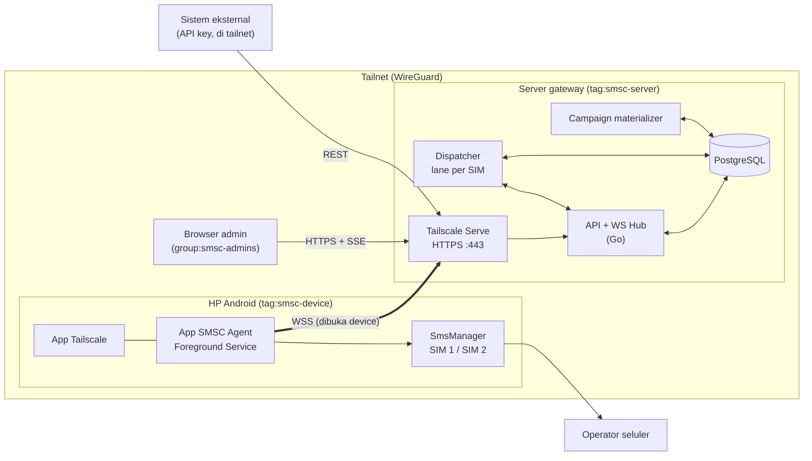
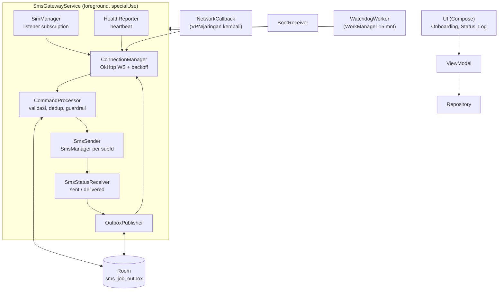
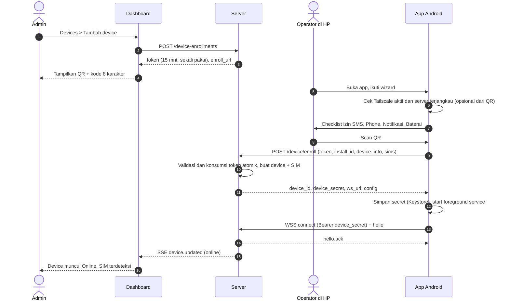
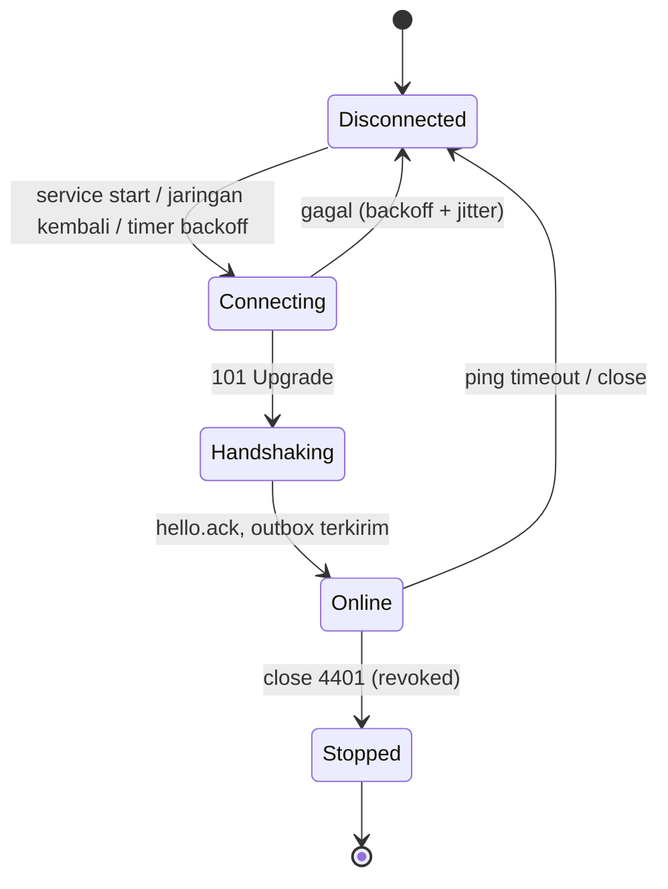
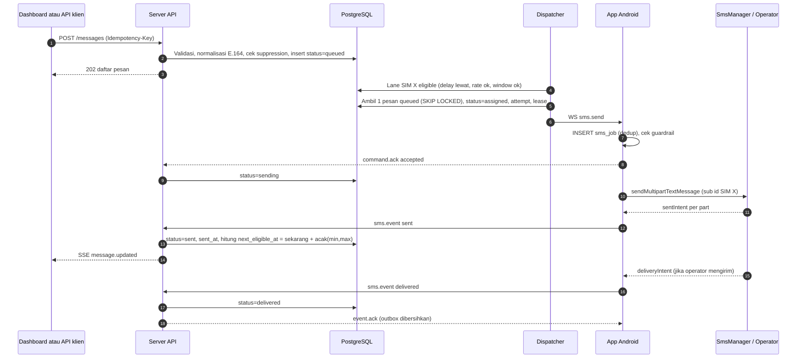
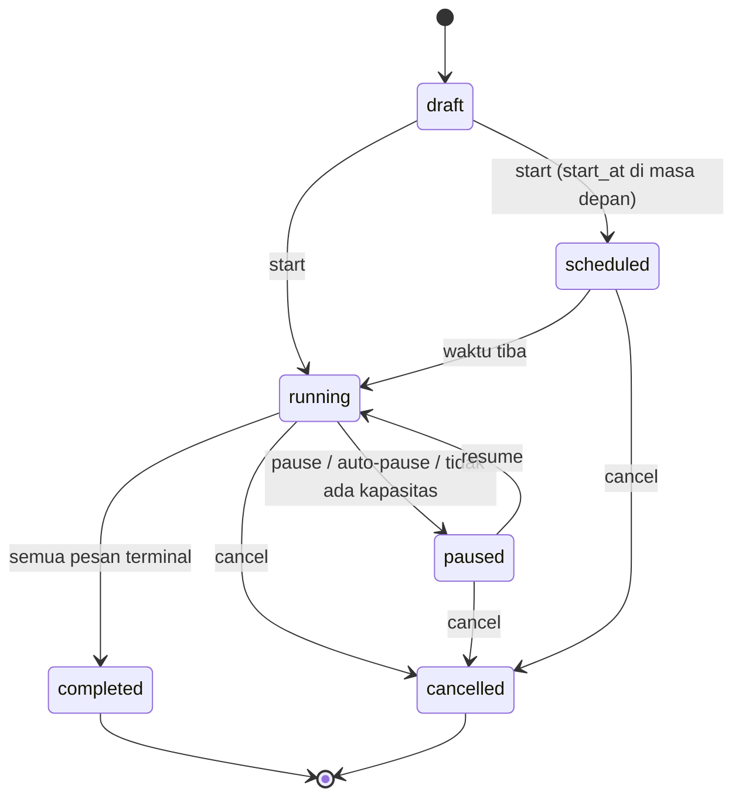
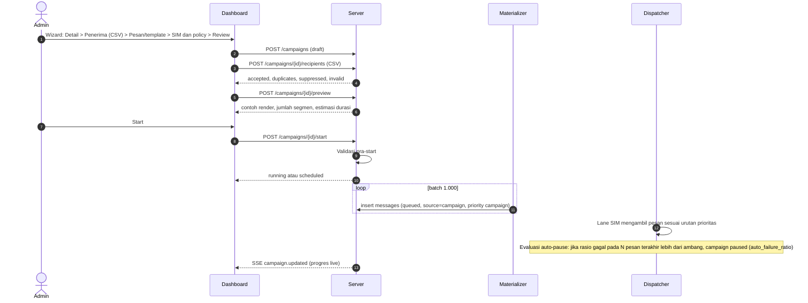
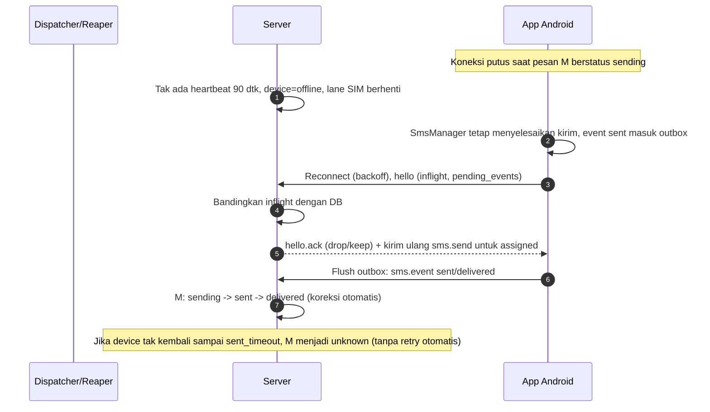

# 02 — Arsitektur dan Flow

## 1. Gambaran arsitektur



### 1.1 Komponen server

| Komponen | Tanggung jawab |
|---|---|
| **API** | REST (`openapi.yaml`), autentikasi sesi/API key, RBAC, validasi, idempotensi. |
| **WS Hub** | Menyimpan koneksi device aktif, auth, heartbeat, rekonsiliasi `hello`, ack/event, kirim perintah. Satu koneksi per device. |
| **Dispatcher** | Penjadwal inti. Satu "lane" logis per SIM: memutuskan kapan dan pesan apa berikutnya dikirim, menegakkan delay/rate-limit/jendela waktu, membuat lease. |
| **Campaign materializer** | Mengubah penerima campaign menjadi baris `messages` (batch 1.000) secara asinkron; mengawasi auto-pause. |
| **Reaper** | Memeriksa lease kedaluwarsa (`ack_timeout`), pesan `sending` tanpa kabar (`sent_timeout` → `unknown`), pesan `expired`, device tanpa heartbeat → `offline`. |
| **Event bus (in-process)** | Menyebarkan perubahan ke SSE dashboard dan pemicu webhook (fase 2). |
| **PostgreSQL** | Sumber kebenaran; antrean = tabel `messages` dengan status. |

### 1.2 Komponen aplikasi Android



Aturan penting di aplikasi:

- **Persist-before-act:** `sms_job` disimpan ke Room sebelum `SmsManager` dipanggil; `outbox` disimpan sebelum event dikirim.
- `SmsStatusReceiver` terdaftar di manifest (bukan dinamis) supaya hasil tetap diterima walau proses sempat dimatikan.
- Wake lock parsial hanya selama pengiriman aktif; koneksi idle mengandalkan foreground service + pengecualian baterai.

## 2. Flow 1 — Setup device (target: ≤ 4 langkah di HP)

Langkah manusia: **(1)** login Tailscale di HP · **(2)** pasang APK · **(3)** satu layar checklist izin · **(4)** scan QR dari dashboard.



Detail wizard di app (satu layar, berurutan, status hijau/merah masing-masing):

| Item | Cara cek | Bila gagal |
|---|---|---|
| Tailscale aktif | `TRANSPORT_VPN` + reachability server | Tombol buka app Tailscale |
| Izin SMS | `SEND_SMS` | Jika terblokir "restricted": arahkan ke App info → Allow restricted settings |
| Izin telepon | `READ_PHONE_STATE`, `READ_PHONE_NUMBERS` | Minta izin |
| Notifikasi (API 33+) | `POST_NOTIFICATIONS` | Minta izin |
| Abaikan optimasi baterai | `PowerManager.isIgnoringBatteryOptimizations` | Intent sistem + panduan per merek |
| (Opsional) Default SMS app | `RoleManager` | Dijelaskan manfaat/risikonya |

Alternatif tanpa QR: dashboard menampilkan tautan `https://smsc.<tailnet>.ts.net/enroll/<token>`; dibuka di browser HP, halaman itu memicu app lewat App Link atau menampilkan kode manual.

Kegagalan: token kedaluwarsa/terpakai → 401, app menampilkan "Minta QR baru"; `install_id` sudah terdaftar dengan token baru → server mengganti kredensial device lama (re-enroll yang sah) dan mencatat audit.

## 3. Flow 2 — Siklus koneksi (standby)



- Heartbeat 30 dtk + ping WS 20 dtk. Server menandai `offline` setelah 90 dtk senyap.
- Perubahan jaringan/VPN (`NetworkCallback`) memicu reconnect langsung tanpa menunggu backoff.
- Watchdog WorkManager memastikan service hidup; jika mati, memulai ulang dan mencatat insiden (dikirim sebagai atribut di `hello`).
- Selama offline, **tidak ada pesan baru yang di-lease ke device tersebut**; pesan `queued` tetap menunggu atau diambil SIM lain bila rute mengizinkan.

## 4. Flow 3 — Kirim SMS non-campaign (dan inti pengiriman semua pesan)



Cabang kegagalan:

| Titik | Kejadian | Hasil |
|---|---|---|
| `assigned` | Tidak ada `command.ack` dalam `ack_timeout` | Lease dicabut → `queued` lagi (tanpa menambah attempt kirim karena belum terkirim), SIM bisa ditandai bermasalah bila berulang |
| `sending` | `sms.event failed` retryable (`no_service`, `radio_off`, `generic_failure`, `os_rate_limited`) dan `attempt < max_attempts` | `queued` dengan `not_before = now + backoff`, attempt+1 |
| `sending` | `failed` non-retryable (`invalid_destination`, `short_code_blocked`, `permission_denied`) | `failed` final |
| `sending` | Device hilang > `sent_timeout` tanpa event | `unknown` (tidak otomatis dikirim ulang) |
| `sent` | Tidak ada laporan delivery sampai `delivery_timeout` (24 jam) | Tetap `sent` (final), ditandai "delivery tidak terkonfirmasi" |
| semua non-terminal | Melewati `expires_at` | `expired` |

Pembatalan: `POST /messages/{id}/cancel` valid saat `queued`/`assigned`. Untuk `assigned`, server mengirim `sms.cancel`; jika device menjawab sudah `sending`, pembatalan ditolak (409).

## 5. Flow 4 — Campaign





Aturan:

- **Prioritas:** non-campaign default 5, campaign default 3 → kirim cepat tidak tertahan oleh campaign besar. Urutan antrean: `priority DESC, not_before ASC, id ASC`.
- **Pause** menahan pesan `queued` (dispatcher mengabaikan pesan campaign yang `paused`); pesan yang sudah `assigned/sending` diselesaikan.
- **Auto-pause** (default aktif): jika dalam `window` pesan terakhir rasio `failed` > `max_failure_ratio`, campaign di-pause dengan `pause_reason=auto_failure_ratio` agar tidak membakar seluruh daftar penerima saat SIM bermasalah. `no_capacity` bila tidak ada SIM yang memenuhi `sim_ids` online selama 10 menit.
- Variabel template yang hilang pada suatu penerima → penerima itu ditolak saat impor/pra-start, bukan dikirim dengan placeholder kosong.
- Penerima yang masuk daftar suppression dilewati dan dihitung di ringkasan impor.

## 6. Flow 5 — Algoritma Dispatcher (manajemen pengiriman)

Dispatcher bersifat *pull per lane*: setiap SIM aktif+online adalah lane yang menarik pesan berikutnya saat siap. Ini otomatis memberi *load balancing* (SIM yang lebih cepat mengambil lebih banyak) tanpa strategi routing terpisah. Dipicu oleh event (pesan masuk, ack, status, timer `next_eligible_at`), bukan polling buta.

```text
lane_ready(sim):
  sim.enabled AND sim.status == active AND device.status in (online, degraded-yang-mengizinkan)
  AND now >= sim.next_eligible_at
  AND inflight(sim) < policy.max_inflight_per_sim          # default 1
  AND dalam send_window (zona waktu policy)
  AND rate_limit(per_minute/hour/day) belum tercapai
  AND os_sms_guard belum tercapai

pick_message(sim):                                         # satu transaksi DB
  SELECT ... FROM messages
   WHERE status='queued' AND not_before <= now() AND expires_at > now()
     AND (campaign_id IS NULL OR campaign.status='running')
     AND route_allows(sim)                                 # sim_ids/device_ids allow-list pesan atau campaign
   ORDER BY priority DESC, not_before, id
   FOR UPDATE SKIP LOCKED LIMIT 1
  UPDATE ... SET status='assigned', sim_id, device_id, attempt=attempt+1 (jika attempt baru), lease_expires_at=now()+ack_timeout

on_terminal_for_inflight(sim, msg):                        # sent / failed / unknown
  burst_count += 1
  delay = uniform(policy.min_delay_ms, policy.max_delay_ms)
  if burst_size and burst_count % burst_size == 0: delay += policy.burst_pause_ms
  sim.next_eligible_at = max(sim.next_eligible_at, now() + delay)
```

Makna "delay antar transaksi": jeda dihitung **dari saat pesan sebelumnya pada SIM yang sama mencapai `sent`/terminal** sampai pesan berikutnya boleh di-lease. Jitter acak `[min,max]` mencegah pola pengiriman seragam.

Resolusi policy efektif (detail di dok. 03 §4): empat lapis; *guardrail* (global/device/SIM) bersifat membatasi — nilai paling konservatif menang — sedangkan lapis campaign/pesan adalah preferensi yang tidak boleh melonggarkan guardrail.

## 7. Flow 6 — Device hilang, reconnect, rekonsiliasi



## 8. Flow 7 — Revoke / ganti device

1. Admin `DELETE /devices/{id}` → kredensial dihapus, WS di-close `4401`, audit tercatat.
2. App menerima `4401` → hapus secret dan data lokal sensitif, kembali ke layar onboarding.
3. Pesan `queued` tidak terpengaruh; `assigned` dikembalikan ke `queued`; `sending` → `unknown` (device-lost rule).

## 9. Dashboard — struktur halaman

| Halaman | Isi utama | Endpoint |
|---|---|---|
| **Overview** | Device online/degraded/offline, kedalaman antrean, kirim hari ini, success rate 24 jam, grafik per jam, peringatan (SIM no service, baterai rendah) | `/stats/overview`, `/stats/timeseries`, SSE |
| **Devices** | Daftar + status; **Tambah device** (QR); detail: info HP, baterai, jaringan, capability flags, SIM, policy, perintah (ping, refresh SIM, restart service, log), revoke | `/devices*`, `/device-enrollments` |
| **SIM** | Tabel lintas device: operator, slot, sinyal, enable/disable, label, policy, counter hari ini, `next_eligible_at` | `/sims*` |
| **Campaigns** | Daftar; wizard pembuatan 5 langkah; detail dengan progres live, pause/resume/cancel, tabel pesan terfilter | `/campaigns*`, `/messages?campaign_id=` |
| **Kirim SMS** | Tempel/ketik nomor (≤ 1.000), isi atau template, pilih SIM/device, jadwal, policy, tombol kirim | `POST /messages` |
| **Transaksi** | Tabel dengan filter (status, sumber, campaign, device, SIM, nomor, tanggal), pencarian, aksi massal retry/cancel, ekspor CSV; detail dengan timeline event | `/messages*` |
| **Template** | CRUD + deteksi variabel + hitung segmen | `/templates*` |
| **Pengaturan** | Dispatch policy (editor delay/rate/jendela/retry + simulasi efektif), policy default, daftar blokir, API key, pengguna & peran, webhook (fase 2), audit log | `/dispatch-policies*`, `/suppressions*`, `/api-keys*`, `/users`, `/audit-logs` |

Peran: **admin** (semua), **operator** (campaign, kirim, transaksi, lihat device/SIM; tidak boleh revoke/pengaturan/pengguna), **viewer** (baca saja, nomor telepon dapat dimasking).
