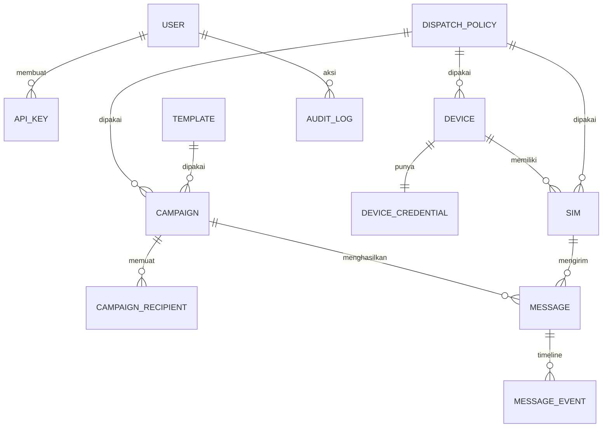
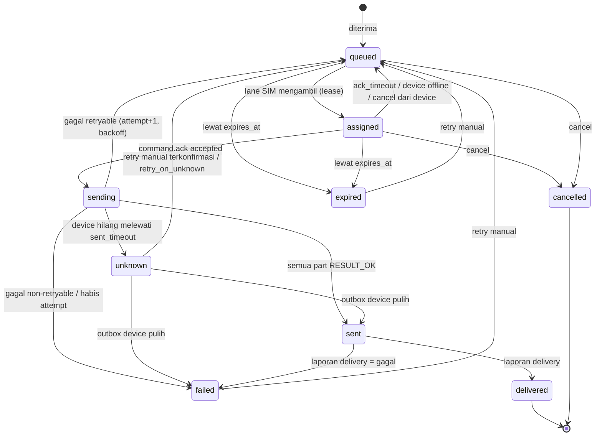

# 03 — Model Data, State Machine, dan Policy

Spesifikasi logis (bukan DDL final). Tipe: `uuid` = UUIDv7, `ts` = `timestamptz`.

## 1. ERD

## 2. Tabel

### `devices`
`id`, `name`, `status` (`pending|online|degraded|offline|revoked`), `status_reason`, `enabled`, `manufacturer`, `model`, `android_version`, `sdk_int`, `app_version`, `install_id` (unique), `capabilities jsonb`, `battery_level`, `charging`, `network_type`, `tailscale_ip`, `policy_id`, `tags text[]`, `last_seen_at`, `connected_since`, `config_version`, `created_at`, `revoked_at`.

### `device_credentials`
`device_id` (PK/FK), `secret_hash` (SHA-256 dari secret 256-bit acak; perbandingan constant-time), `prev_secret_hash`, `prev_valid_until` (grace rotasi), `created_at`, `rotated_at`.

### `device_enrollments`
`id`, `token_hash`, `short_code_hash`, `device_name`, `policy_id`, `created_by`, `expires_at`, `consumed_at`, `consumed_by_device_id`. Konsumsi atomik: `UPDATE … SET consumed_at=now() WHERE id=… AND consumed_at IS NULL AND expires_at>now()`.

### `sims`
`id`, `device_id`, `slot_index` (**unique bersama `device_id`**), `subscription_id` (hint), `carrier_name`, `display_name`, `phone_number`, `is_esim`, `label`, `enabled`, `status` (`active|no_service|absent|disabled`), `signal_level`, `registered`, `roaming`, `policy_id`, `next_eligible_at`, `burst_count`, `last_seen_at`. SIM yang hilang dari `sim.report` menjadi `absent` (tidak dihapus agar riwayat pesan tetap valid).

### `dispatch_policies`
`id`, `name`, `is_default`, dan kolom policy (semua nullable = diwarisi): `min_delay_ms`, `max_delay_ms`, `burst_size`, `burst_pause_ms`, `max_inflight_per_sim`, `rate_per_minute`, `rate_per_hour`, `rate_per_day`, `send_window jsonb`, `max_attempts`, `retry_backoff_ms`, `retry_backoff_max_ms`, `message_ttl_seconds`, `track_delivery`, `ack_timeout_ms`, `sent_timeout_ms`, `retry_on_unknown`, `updated_at`. Tepat satu baris `is_default=true` (partial unique index) dan baris itu **tidak boleh** memiliki nilai null pada field wajib.

### `templates`
`id`, `name`, `body`, `variables text[]` (diturunkan dari `{{var}}`), `updated_at`.

### `campaigns`
`id`, `name`, `description`, `status`, `pause_reason`, `body` / `template_id` (salah satu), `sim_ids uuid[]`, `policy_id`, `priority`, `start_at`, `auto_pause jsonb`, `counters jsonb` (di-*maintain* oleh trigger/job; sumber kebenaran tetap `messages`), `created_by`, `created_at`, `started_at`, `finished_at`.

### `campaign_recipients`
`id`, `campaign_id`, `row_no`, `to_raw`, `to_e164`, `vars jsonb`, `client_ref`, `materialized_at`. Unique `(campaign_id, to_e164)` bila `dedupe`.

### `messages` (antrean + transaksi)
`id`, `source` (`dashboard|api|campaign`), `campaign_id`, `recipient_id`, `client_ref`, `idempotency_key`, `api_key_id`/`user_id`, `to_e164`, `body`, `encoding`, `parts`, `status`, `attempt`, `max_attempts`, `error_code`, `error_detail`, `priority`, `route_sim_ids uuid[]`, `route_device_ids uuid[]`, `policy_id` (override), `device_id`, `sim_id`, `not_before`, `expires_at`, `lease_expires_at`, `created_at`, `assigned_at`, `sent_at`, `delivered_at`, `finished_at`.

Indeks kunci:

| Indeks | Tujuan |
|---|---|
| `(priority DESC, not_before, id) WHERE status='queued'` | Pengambilan dispatcher |
| `(lease_expires_at) WHERE status='assigned'` | Reaper lease |
| `(device_id, status) WHERE status IN ('assigned','sending')` | Rekonsiliasi & device-lost |
| `(campaign_id, status)` | Counter & filter |
| `(created_at DESC, id DESC)` | Daftar transaksi / cursor |
| `(to_e164, created_at DESC)` | Pencarian nomor |
| `(sim_id, sent_at)` | Perhitungan rate limit |
| unique `(idempotency_key, COALESCE(api_key_id,user_id))` | Idempotensi |
| unique `(source, client_ref)` WHERE `client_ref IS NOT NULL` AND `source='api'` | Anti-duplikat klien eksternal |

Partisi bulanan pada `messages`/`message_events` direncanakan jika > ~10 juta baris; tidak perlu sejak awal.

### `message_events`
`id`, `message_id`, `attempt`, `type`, `at`, `actor`, `sim_id`, `error_code`, `data jsonb`, `device_event_id` (unique, untuk dedup event dari device). Append-only.

### Lainnya
`suppressions(id, number_e164 unique, reason, created_by, created_at)` · `users(id, email unique, password_hash argon2id, role, disabled)` · `sessions` · `api_keys(id, name, prefix, key_hash, scopes[], expires_at, last_used_at)` · `webhooks`, `webhook_deliveries` (fase 2) · `audit_logs(id, at, actor, action, target_type, target_id, data)` · `settings(key, value)`.

## 3. State machine pesan

Terminal: `delivered`, `failed`, `cancelled`, `expired`; `sent` terminal setelah `delivery_timeout` atau bila `track_delivery=false`; `unknown` menunggu pemulihan/keputusan operator.

Invarian:

1. Perpindahan status hanya lewat satu fungsi transisi server yang memvalidasi graf di atas dan menulis `message_events` dalam transaksi yang sama.
2. `attempt` bertambah hanya saat pesan **di-lease untuk dikirim lagi setelah attempt sebelumnya gagal**, bukan pada requeue karena `ack_timeout` sebelum pernah `sending`.
3. Event dari device dengan `attempt` < attempt terkini diabaikan (hanya dicatat).
4. Satu pesan tidak pernah `assigned` pada dua SIM sekaligus (dijamin `FOR UPDATE SKIP LOCKED` + update bersyarat status).

## 4. Dispatch policy — resolusi berlapis

Urutan lapis: **global default → device → SIM** (*guardrail*) lalu **campaign → pesan** (*preferensi*).

| Kelompok field | Aturan merge |
|---|---|
| `min_delay_ms`, `max_delay_ms`, `burst_pause_ms` | Guardrail: ambil **maksimum** antar lapis guardrail (paling lambat/konservatif). Preferensi campaign/pesan dapat memperbesar, tidak memperkecil. Setelah merge dijamin `max ≥ min`. |
| `rate_per_*`, `max_inflight_per_sim`, `burst_size` | Ambil **minimum** (paling ketat) di semua lapis. |
| `send_window` | **Irisan** semua jendela yang diatur. Irisan kosong → validasi gagal saat menyimpan/start. |
| `max_attempts`, `retry_*`, `message_ttl_seconds`, `track_delivery`, `ack/sent_timeout`, `retry_on_unknown` | Lapis terdekat dengan pesan yang tidak-null menang (pesan > campaign > SIM > device > global). |

Endpoint `GET /dispatch-policies/{id}/effective?sim_id=` mengembalikan hasil merge untuk debugging UI ("kenapa SIM ini lambat?").

Nilai default global yang disarankan (dapat diubah admin):

| Parameter | Default |
|---|---|
| `min_delay_ms` / `max_delay_ms` | 3.000 / 8.000 |
| `burst_size` / `burst_pause_ms` | 20 / 60.000 |
| `max_inflight_per_sim` | 1 |
| `rate_per_minute` / `hour` / `day` | 10 / 300 / 2.000 |
| `send_window` | 08:00–20:00 `Asia/Jakarta`, setiap hari |
| `max_attempts` | 3 |
| `retry_backoff_ms` / `max` | 30.000 / 600.000 (eksponensial ×2) |
| `message_ttl_seconds` | 86.400 |
| `track_delivery` | true |
| `ack_timeout_ms` / `sent_timeout_ms` | 15.000 / 120.000 |
| `retry_on_unknown` | false |

`os_sms_guard` (default 25 pesan / 30 menit per device bila `os_sms_limit_unlocked=false`) adalah guardrail terpisah yang dilaporkan dari capability device, bukan field policy.

## 5. Kode error (kontrak `ErrorCode`)

| Kode | Sumber | Retry | Keterangan |
|---|---|---|---|
| `invalid_destination` | device | tidak | Nomor ditolak OS/format |
| `short_code_blocked` | device | tidak | Short code ditolak sistem |
| `permission_denied` | device | tidak | Izin SMS dicabut → device `degraded` |
| `radio_off` | device | ya | Mode pesawat |
| `no_service` | device | ya | Tidak ada sinyal |
| `generic_failure` | device | ya | Kegagalan umum radio/operator |
| `null_pdu` | device | tidak | Pesan tak valid |
| `os_rate_limited` | device | ya (backoff panjang) | Batas OS tercapai |
| `sim_unavailable` | device | ya (SIM lain) | Slot kosong/nonaktif |
| `delivery_failed` | device | tidak | Laporan operator: gagal |
| `ack_timeout` | server | ya | Device tidak menjawab |
| `sent_timeout` | server | – | Memicu `unknown` |
| `device_lost` / `device_revoked` | server | tergantung | Lihat aturan device-lost |
| `expired` | server | tidak | Melewati TTL |
| `suppressed` | server | tidak | Nomor di daftar blokir |

## 6. Aturan device-lost

| Status saat device hilang/dicabut | Perlakuan |
|---|---|
| `assigned` (belum ack) | Kembali `queued` setelah `ack_timeout`. |
| `sending` | Menunggu `sent_timeout` untuk koreksi dari outbox; lalu `unknown`. Tidak ada kirim ulang otomatis kecuali `retry_on_unknown=true`. |
| `queued` | Tidak terpengaruh. |
| Device direvoke | `assigned`→`queued`; `sending`→`unknown` dengan `device_revoked`. |

## 7. Retensi dan privasi

- Nomor dan isi SMS adalah data pribadi. `messages.body` dapat dibersihkan setelah N hari (`body_retention_days`, default 90) sambil mempertahankan metadata; `message_events` ikut retensi `event_retention_days` (default 180).
- Peran `viewer` melihat nomor termasking (`+62812****7890`); log aplikasi/server tidak mencatat `body`.
- Audit log tidak dihapus oleh retensi pesan.
