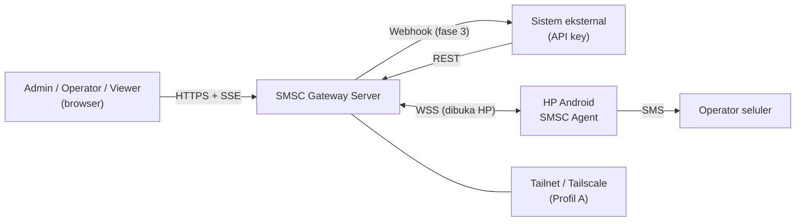

# Spec 02 — Arsitektur Sistem dan Keputusan (ADR)

Melengkapi `docs/02` (flow) dan `docs/04` (deployment). Dokumen ini menetapkan batas komponen, keputusan arsitektur, mode kegagalan, dan atribut kualitas.

## 1. Konteks sistem

Batas kepercayaan: (1) browser ↔ server, (2) sistem eksternal ↔ server, (3) HP ↔ server, (4) server ↔ PostgreSQL. HP dianggap *semi-tidak-tepercaya* (bisa dicuri/dimodifikasi): server tidak mengirim apa pun selain `sms.send` ke SIM miliknya dan perintah enum terbatas.

## 2. Pemecahan komponen

| Komponen | Proses | State | Skala |
|---|---|---|---|
| API (REST + SSE) | Biner `smscd` | Stateless (sesi di DB) | Vertikal |
| WS Hub | `smscd` (in-process) | Peta `device_id → koneksi` di memori | Satu instance (v1) |
| Dispatcher | `smscd` (goroutine) | Cache lane di memori, **dapat dibangun ulang dari DB** | Satu leader (advisory lock) |
| Materializer / Reaper / Retensi | `smscd` (goroutine) | DB | Satu leader |
| Event bus | in-process | Ring buffer SSE 5 mnt | – |
| PostgreSQL | proses terpisah | Sumber kebenaran | Backup + opsional replika |
| Dashboard | file statis di-embed pada `smscd` | – | – |
| Aplikasi Android | HP | Room (job, outbox) | Satu per HP |

**WS Hub multi-instance (fase 20).** Device boleh tersambung ke instance mana pun di belakang load balancer. Instance mencatat sesi di `device_sessions` (heartbeat 5 dtk; basi > 20 dtk dianggap hilang) dan memuat sesi instance lain ke cache tiap `HUB_TICK`. `Send/Request/Close` ke device di instance lain dititipkan ke `hub_commands` (durable) dan `NOTIFY smsc_hub` membangunkan penerima; penerima juga mem-poll tabel sehingga NOTIFY hilang tidak menghilangkan perintah. `command.ack` dikaitkan lewat `cmd_refs` (bukan memori). Event SSE (`Bus`) dan `Wake` diteruskan lewat `NOTIFY smsc_bus`/`smsc_wake` (payload > 7 KB dilewati dan dihitung `smsc_hub_relay_total{result="dropped"}`). Sesi baru di instance lain menutup yang lama (4409) tanpa menandai device offline. Tabel `UNLOGGED` (efemeral).

**Pengambilalihan leader (fase 21).** Sebelum worker leader dijalankan, leader baru memulihkan pesan `assigned` yang lease-nya masih berlaku atau habis sejak leader sebelumnya terakhir terlihat (`settings.leader_seen`): lease diperbarui sepanjang ack timeout dan `sms.send` dikirim ulang (device idempoten). Pesan `sending` tidak disentuh.

**Leader election.** `smscd` mengambil `pg_try_advisory_lock(k)` pada koneksi khusus untuk menjalankan komponen leader (dispatcher, reaper, materializer, retensi). Sejak fase 19 lock dipantau tiap `LEADER_TICK` (default 5 dtk): bila hilang (koneksi putus/di-terminate, DB restart) worker dihentikan, `smsc_leader` turun ke 0, dan instance mana pun (termasuk yang sama) memilih ulang — standby mengambil alih tanpa restart. Dengan satu instance, selalu memenangkannya; memungkinkan rolling restart aman dan jalan menuju multi-instance (fase 4, butuh pub/sub antar-instance untuk WS Hub).

## 3. Keputusan arsitektur (ADR)

Format: Konteks → Keputusan → Konsekuensi. Status semua: *Diterima*.

**ADR-01 Transport: WebSocket yang dibuka HP.**
Perintah harus tiba kapan saja tanpa menjangkau HP dari luar. → HP membuka WSS keluar, server mendorong perintah di kanal itu. → Perlu heartbeat, reconnect, rekonsiliasi; server tak perlu tahu IP HP; FCM tidak dipakai.

**ADR-02 Jaringan: Tailscale sebagai profil default, protokol agnostik jaringan.**
Server privat tanpa port publik. → Profil A tailnet, Profil B WSS publik didukung oleh kontrak yang sama. → Dua profil perlu didokumentasi/diuji; kode tidak boleh mengasumsikan alamat tailnet.

**ADR-03 Server sebagai sumber kebenaran, antrean di PostgreSQL.**
Skala kecil, butuh konsistensi lease dan audit. → `messages` + `FOR UPDATE SKIP LOCKED`, tanpa Redis/broker. → Throughput antrean dibatasi DB (ribuan/dtk, jauh di atas kebutuhan); multi-instance butuh advisory lock + pub/sub.

**ADR-04 Dispatcher pull-per-lane, jeda dihitung dari kejadian terminal pesan sebelumnya.**
Delay antar kirim harus dapat diprediksi dan load balancing otomatis. → `next_eligible_at` per SIM, `max_inflight_per_sim=1` default. → Throughput SIM = 1/(delay+waktu kirim); SIM cepat mengambil lebih banyak pesan.

**ADR-05 Pengiriman at-least-once + dedup di device, bukan exactly-once.**
SMS tidak idempoten di sisi penerima. → `sms_job(message_id PK)` ditulis sebelum `SmsManager`; kasus tak pasti → `unknown`. → Operator kadang perlu memutuskan; risiko SMS ganda dibatasi pada keputusan eksplisit.

**ADR-06 Policy berlapis dengan semantik "paling ketat menang" untuk guardrail.**
Operator campaign tidak boleh melonggarkan batas aman SIM/device. → Merge per kelompok field (dok. 03 §4 di docs/). → UI perlu tampilan "policy efektif".

**ADR-07 Identitas SIM = `(device_id, slot_index)`.**
`subscriptionId` dan ICCID tak stabil/tak terbaca. → Resolusi subId saat kirim. → Pertukaran fisik SIM antar slot terlihat sebagai pergantian SIM; diterima.

**ADR-08 Dashboard realtime dengan SSE (bukan WebSocket).**
Aliran satu arah, reconnect + `Last-Event-ID` bawaan. → Server menyimpan ring buffer; selebihnya refetch.

**ADR-09 Distribusi sideload; foreground service `specialUse`.**
Play membatasi izin SMS; `dataSync` dibatasi durasi di Android 15. → Update APK dikelola sendiri (fase 3). → Perlu panduan "restricted settings".

**ADR-10 Backend Go, dashboard React, kontrak-first (OpenAPI + JSON Schema).**
Satu biner, konkurensi sederhana, tipe dihasilkan dari kontrak. → Perubahan perilaku dimulai di `contracts/`. → CI wajib memvalidasi kontrak dan test vector.

**ADR-11 Single-tenant, satu instance server pada v1.**
Kebutuhan awal kecil. → Skema tanpa `tenant_id`; menambahkannya kemudian adalah migrasi besar yang diterima.

## 4. Mode kegagalan

| Kegagalan | Dampak | Perilaku sistem | Pemulihan |
|---|---|---|---|
| Server restart | WS putus, dispatcher berhenti sementara | HP reconnect (backoff), `hello` rekonsiliasi; lease kedaluwarsa dibersihkan reaper | Otomatis ≤ 1 menit |
| DB tidak tersedia | API 503, dispatcher berhenti | `readyz` gagal; WS tetap hidup tetapi event ditampung outbox HP | Otomatis saat DB pulih |
| Jaringan HP putus | Device `offline` | Lane berhenti, pesan `queued` tetap; `sending` → ikuti aturan device-lost | Reconnect + flush outbox |
| Tailscale mati di HP | Seperti jaringan putus; heartbeat melaporkan VPN mati bila sempat | Peringatan di dashboard | Operator membuka Tailscale / Always-on VPN |
| Proses app dimatikan OS/OEM | Koneksi putus | Watchdog 15 mnt / boot receiver memulai ulang; job di Room dilanjutkan (cek status) | Otomatis; sering → panduan OEM |
| SIM kehilangan sinyal | `no_service` | Lane SIM berhenti; auto-pause campaign bila rasio gagal tinggi | Otomatis saat sinyal kembali |
| HP kehabisan baterai | Device offline | Sama seperti jaringan putus | Operator mengisi daya |
| Jam HP miring | Jendela waktu & TTL salah di sisi device | Server memakai waktunya sendiri; `clock_skew_ms` → `degraded` | Sinkronkan waktu |
| Event duplikat/terlambat | Status mundur | Dedup `event_id`; abaikan `attempt` lama; transisi tervalidasi | – |
| Disk server penuh | DB gagal tulis | Alert disk; retensi body | Operator |

## 5. Atribut kualitas dan taktik

| Atribut | Taktik |
|---|---|
| Keandalan pengiriman | Lease + ack timeout, outbox, rekonsiliasi `hello`, retry terkontrol, status `unknown` |
| Keamanan | Auth berlapis per aktor, secret ter-hash, token enroll sekali pakai, ACL tailnet, guardrail lokal HP |
| Performa | Indeks parsial untuk antrean, dispatcher event-driven, SSE batching 250 ms |
| Operabilitas | Satu biner + Postgres, `/metrics`, log JSON, runbook |
| Evolusi | Versi protokol & API, migrasi expand/contract, pengujian kontrak |
| Privasi | Masking, retensi body, log tanpa body |

## 6. Konfigurasi dan waktu

- Sumber waktu otoritatif adalah server (UTC). Semua `not_before`, `expires_at`, jendela waktu dievaluasi server; HP hanya menegakkan `not_after` dan `min_gap_ms`.
- Konfigurasi proses lewat env (dok. 10 §2); konfigurasi bisnis (policy, retensi) di DB dan dapat diubah dari dashboard tanpa restart.
- ID UUIDv7 dibuat di aplikasi (urut waktu, baik untuk indeks).

## 7. Peta dokumen spec

| Topik | Dokumen |
|---|---|
| Desain app | spec 03 · Desain backend | spec 04 |
| API | spec 05 · Protokol device | spec 06 |
| Data | spec 07 · Dashboard | spec 08 |
| Keamanan | spec 09 · Operasi | spec 10 · Panduan pengguna | spec 11 · Uji | spec 12 |
