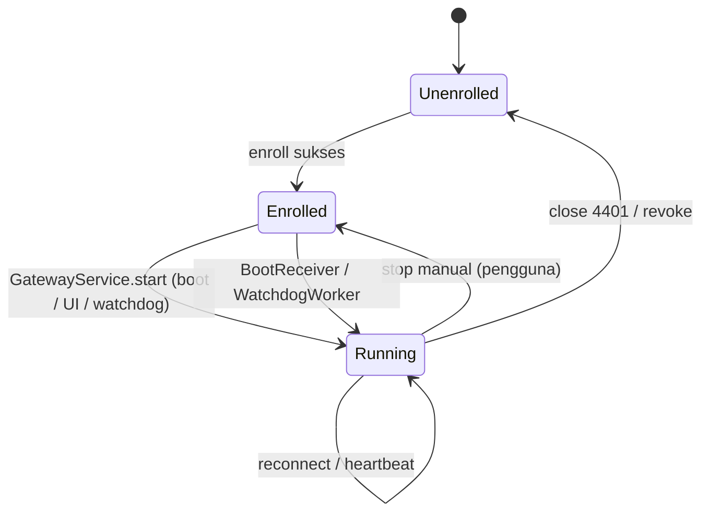

# Spec 03 — Desain Aplikasi Android (SMSC Agent)

Cakupan: `minSdk 29` (Android 10) sampai terbaru. Kontrak komunikasi: `contracts/device-ws-protocol.md` dan `contracts/ws-schema.json`.

## 1. Struktur modul dan paket

Single Gradle module `:app` di v1.

```
id.smsc.agent
├─ ui/            Compose: onboarding, status, log, pengaturan
├─ domain/        model, use case (Enroll, StartGateway, HandleSendCommand, ...)
├─ data/
│  ├─ local/      Room (SmsJobDao, OutboxDao), KeyStore wrapper, DataStore
│  ├─ remote/     OkHttp: EnrollApi (REST), GatewaySocket (WS), JSON models (sealed)
│  └─ device/     SimRepository, BatteryRepository, NetworkRepository, PermissionChecker
├─ service/       GatewayService, ConnectionManager, CommandProcessor, SmsSender,
│                 SmsStatusReceiver, OutboxPublisher, HealthReporter, Guardrails
├─ system/        BootReceiver, WatchdogWorker, NotificationFactory
└─ di/            Hilt modules
```

Dependensi arah: `ui → domain → data`; `service → domain/data`. Kelas `service/*` tidak bergantung pada UI.

## 2. Izin dan manifest per versi Android

| Izin | Kapan | Catatan |
|---|---|---|
| `SEND_SMS` | Semua | Runtime. Terblokir sampai "restricted settings" diizinkan (sideload, Android 13+). |
| `READ_PHONE_STATE` | Semua | Daftar SIM & status; runtime. |
| `READ_PHONE_NUMBERS` | Opsional | Nomor SIM; sering kosong. Tidak boleh dijadikan syarat. |
| `INTERNET`, `ACCESS_NETWORK_STATE`, `CHANGE_NETWORK_STATE` | Semua | Normal. |
| `FOREGROUND_SERVICE` | API 28+ | Normal. |
| `FOREGROUND_SERVICE_SPECIAL_USE` | API 34+ | Wajib untuk `foregroundServiceType="specialUse"`; sertakan `<property android:name="android.app.PROPERTY_SPECIAL_USE_FGS_SUBTYPE" android:value="Remote SMS gateway persistent connection"/>`. |
| `POST_NOTIFICATIONS` | API 33+ | Runtime; tanpa izin, notifikasi FGS tetap berjalan tetapi tersembunyi — wizard menandainya "disarankan". |
| `RECEIVE_BOOT_COMPLETED` | Semua | Auto-start. |
| `WAKE_LOCK` | Semua | Wake lock parsial singkat selama kirim. |
| `REQUEST_IGNORE_BATTERY_OPTIMIZATIONS` | Semua | Dialog sistem langsung untuk app ini. |
| `CAMERA` | Onboarding | Hanya untuk scan QR; boleh dicabut setelahnya. |

Catatan perilaku per versi:

| Versi | Hal yang ditangani |
|---|---|
| Android 10 (29) | Batasan start background dari Activity; layanan dimulai dari boot receiver/FGS. |
| Android 11–12 | Izin otomatis dicabut bila app tak dipakai lama ("auto-reset permissions") → matikan lewat Settings, wizard menyarankan; Android 12: batasan start FGS dari background (dikecualikan untuk boot & aksi pengguna). |
| Android 13 | `POST_NOTIFICATIONS`; *restricted settings* untuk sideload. |
| Android 14 | Tipe FGS wajib; izin tipe spesifik. |
| Android 15+ | `specialUse` tidak dibatasi 6 jam seperti `dataSync`; dilarang start FGS tertentu dari `BOOT_COMPLETED` (bukan `specialUse`). Tetap uji ulang tiap rilis target SDK. |

## 3. Siklus hidup service



- `GatewayService` (FGS `specialUse`), `START_STICKY`, notifikasi permanen low-priority menampilkan: status koneksi, jumlah antrean lokal, SIM aktif.
- `BootReceiver` (`BOOT_COMPLETED`, `LOCKED_BOOT_COMPLETED` tidak dipakai karena Keystore butuh unlock) memulai service jika `Enrolled`.
- `WatchdogWorker` (WorkManager periodik 15 mnt, constraint tanpa jaringan): bila service tidak berjalan → start; mencatat insiden `service_restarts` di DataStore, dikirim di `hello`.
- Pengguna dapat menghentikan gateway dari UI (konfirmasi); status `stopped_by_user` dilaporkan lewat `hello`/heartbeat terakhir bila sempat, dan watchdog menghormatinya sampai dimulai lagi.

## 4. ConnectionManager

Tanggung jawab: satu WebSocket aktif, auth, ping, reconnect, dispatch pesan masuk.

- OkHttp `WebSocket` dengan `pingInterval = ws_ping_interval_sec`; header `Authorization: Bearer <secret>`, subprotocol `smsc.v1`.
- Setelah `onOpen`: kirim `hello` (inflight dari Room, `pending_events` dari outbox) → tunggu `hello.ack` (timeout 10 dtk → tutup & backoff) → jalankan `reconcile` → flush outbox → mulai heartbeat.
- Backoff: `min(60s, 1s·2^n)` dengan full jitter; reset setelah 60 dtk stabil. Trigger langsung: `NetworkCallback.onAvailable` untuk jaringan non-VPN **atau** VPN (Tailscale kembali).
- Close code ditangani sesuai tabel protokol §4 (4401 → `Unenrolled`; 4409 → tunggu 30 dtk; 4426 → berhenti, tampilkan "Perbarui aplikasi").
- Frame masuk diparse ke sealed class `ServerMessage`; `type` tak dikenal diabaikan. Pesan > 64 KiB ditolak.
- Antrean kirim keluar: `Channel` dengan kapasitas terbatas; prioritas: `command.ack` > `sms.event` > `heartbeat`.

## 5. CommandProcessor dan pengiriman SMS

### 5.1 Alur `sms.send`

```text
onSmsSend(cmd):
  validasi skema; now > cmd.not_after  -> ack(rejected, expired)
  tx Room:
    jika sms_job(message_id) ada:
        jika existing.attempt >= cmd.attempt -> ack(rejected, duplicate | already_sending), selesai
    resolve SIM: slot_index -> subscriptionId aktif (SubscriptionManager)
        tidak ada/nonaktif -> ack(rejected, sim_unavailable)
    izin SEND_SMS hilang -> ack(rejected, permission_denied), tandai degraded
    INSERT/UPSERT sms_job(message_id, attempt, state='accepted', parts_total, sim_slot, created_at)
  ack(accepted)
  jadwalkan ke SendLane(slot):   # antrean per SIM, serial
      tunggu guardrail (min_gap_ms sejak kirim terakhir di slot itu, rate lokal, os_sms_guard)
      state='sending'; emit event(sending)
      parts = smsManager.divideMessage(body)
      sendMultipartTextMessage(to, null, parts, sentIntents[], deliveryIntents[] atau null)
```

Aturan:

1. `SmsManager.createForSubscriptionId(subId)` pada setiap kirim (jangan menyimpan instance lama).
2. Setiap part mendapat `PendingIntent` eksplisit (komponen `SmsStatusReceiver`, `FLAG_IMMUTABLE`) dengan extra `message_id`, `attempt`, `part_index`, `kind=sent|delivered`; `requestCode` unik = hash(`message_id`,`attempt`,`part_index`,`kind`) agar tidak saling menimpa.
3. Pengecualian saat memanggil `SmsManager` (`IllegalArgumentException`, `SecurityException`) → event `failed` dengan kode terpetakan, tanpa menunggu intent.
4. Konkurensi: satu `SendLane` per slot, serial; antar slot paralel.

### 5.2 SmsStatusReceiver

Terdaftar di manifest (exported=false). Menerima `kind=sent` / `delivered` per part:

- `sent`: `resultCode == RESULT_OK` → increment `parts_sent`; semua part → `sent` (event). Kode lain → `failed` dengan pemetaan tabel protokol §3.6 (hanya event pertama yang gagal yang menentukan; part sukses lain diabaikan).
- `delivered`: PDU status report (`SmsMessage.createFromPdu(...).status`): `0` = sukses → increment `parts_delivered`; status permanen gagal → `delivery_failed`; status sementara (pending) diabaikan menunggu laporan akhir.
- Semua pembaruan: transaksi Room (`sms_job` + `outbox` insert) lalu `goAsync()` selesai; publikasi outbox dipicu setelahnya.
- Receiver harus selesai < 10 dtk; pekerjaan jaringan tidak dilakukan di sini.

### 5.3 Guardrail lokal

| Guardrail | Sumber | Perilaku |
|---|---|---|
| `min_gap_ms` | `sms.send` / config | Tunda kirim sampai gap tercapai pada slot yang sama |
| `max_per_minute` | config | Tunda ke menit berikutnya; tidak membuang |
| `os_sms_guard` (default 25/30 mnt) | config + capability | Mencegah pemicu dialog OS. Terlampaui → tunda; bila tertunda melewati `not_after` → `failed(expired)` |
| Pengecekan `not_after` | `sms.send` | Sebelum memanggil `SmsManager` |

## 6. Penyimpanan lokal (Room)

```text
sms_job(
  message_id TEXT PK, attempt INT, state TEXT,       -- accepted|sending|sent|delivered|failed
  sim_slot INT, to_e164 TEXT, body TEXT,             -- body dihapus saat terminal (privasi)
  parts_total INT, parts_sent INT, parts_delivered INT,
  error_code TEXT, not_after INTEGER,
  created_at INTEGER, updated_at INTEGER)
outbox(
  event_id TEXT PK, message_id TEXT, payload_json TEXT, created_at INTEGER, sent_at INTEGER NULL)
kv(key TEXT PK, value TEXT)                          -- config_version, install_id, insiden watchdog
```

- `sms_job` terminal dipertahankan 7 hari untuk dedup, lalu dihapus (`body` dihapus segera saat terminal).
- `outbox` dihapus saat `event.ack`; batas 10.000 baris — jika terlampaui, event non-terminal (`part_*`, `sending`) dibuang lebih dulu.
- `device_secret` tidak disimpan di Room: dienkripsi AEAD (AES-GCM, kunci di Android Keystore, tanpa autentikasi pengguna) dan disimpan di DataStore. `allowBackup=false`, `dataExtractionRules` mengecualikan semuanya.

## 7. SimManager dan HealthReporter

- `SimManager`: daftar via `SubscriptionManager.getActiveSubscriptionInfoList()`; `OnSubscriptionsChangedListener` memicu `sim.report` (debounce 2 dtk). Sinyal/registrasi dari `TelephonyCallback` (API 31+) atau `PhoneStateListener` (API 29–30) per `createForSubscriptionId`.
- `HealthReporter`: heartbeat tiap `heartbeat_interval_sec`: baterai (`BatteryManager` sticky), jaringan (`ConnectivityManager`; `TRANSPORT_VPN` ⇒ `tailscale_vpn_active`), SIM runtime, `queue_depth_local`, `clock_skew_ms` (selisih jam HP vs `ts` server pada `hello.ack`), uptime proses.
- Capability dihitung ulang tiap start dan saat izin berubah: `default_sms_app`, `battery_optimization_ignored`, `notifications_enabled`, `restricted_settings_allowed` (hasil uji coba `checkSelfPermission` + heuristik), `os_sms_limit_unlocked` (default `false`, `true` bila `ROLE_SMS` dipegang atau di-set manual lewat konfigurasi server).

## 8. Onboarding (UI)

Layar tunggal bertahap dengan indikator per item (hijau/merah) — lihat tabel wizard di `docs/02` §2. Urutan eksekusi:

1. **Server**: scan QR (CameraX + ML Kit) atau input kode; parsing `smsc://enroll?s=<url>&t=<token>`; validasi skema `https`.
2. **Prasyarat**: cek VPN aktif + `GET <server>/healthz` (timeout 5 dtk). Gagal → tombol "Buka Tailscale".
3. **Izin**: SMS → telepon → notifikasi → baterai; deteksi penolakan permanen → arahkan ke App info.
4. **Enroll**: `POST /device/enroll` → simpan kredensial → start service → tunggu `hello.ack` → layar "Online ✓".

Layar status: status koneksi, SIM + sinyal, antrean lokal, 20 log terakhir (tanpa isi SMS), tombol: uji koneksi, bagikan log, hentikan, keluar (hapus kredensial; hanya setelah konfirmasi, memberi tahu bahwa admin perlu revoke di server).

## 9. Penanganan OEM

Deteksi `Build.MANUFACTURER`; tampilkan panduan khusus dan intent deep-link ke layar pengaturan vendor bila tersedia (dengan `try/catch` — intent bisa tidak ada):

| Merek | Tindakan |
|---|---|
| Xiaomi/Redmi/Poco (MIUI/HyperOS) | Autostart ON; Battery saver → "No restrictions"; kunci app di Recents |
| Oppo/Realme/OnePlus (ColorOS/OxygenOS) | Allow auto-launch; Allow background activity; matikan "Auto optimize" |
| Vivo/iQOO | Autostart; High background power consumption |
| Samsung (OneUI) | Never sleeping apps; matikan Adaptive battery & "Put unused apps to sleep" |
| Huawei/Honor | App launch → Manage manually (3 toggle) |
| Pixel/AOSP | Cukup pengecualian optimasi baterai |

## 10. Logging, privasi, dan error handling

- Logger lokal ring buffer 2.000 baris (memori + file), **tanpa** `body` dan nomor penuh (nomor dimasking `+62812****7890`). `upload_logs` mengirim buffer ini.
- Semua pengecualian di receiver/service ditangkap; kegagalan tak terduga → event `failed(generic_failure)` + catat; tidak ada crash yang menghentikan service (UncaughtExceptionHandler mencatat dan memulai ulang service via watchdog).
- Waktu memakai `System.currentTimeMillis()` untuk `at`; tidak dipakai untuk keputusan selain `not_after` dan guardrail.

## 11. Build, penandatanganan, update

- Gradle KTS + version catalog; R8 aktif (rilis) dengan aturan keep untuk model JSON.
- APK ditandatangani dengan kunci rilis milik organisasi; `versionCode` monoton; `app_version` dilaporkan ke server.
- v1.1: server menyediakan metadata versi minimum/terbaru; update dilakukan manual atau lewat MDM. Tidak ada auto-install tanpa pengguna (tidak mungkin tanpa privilege).
- Dependency utama: Compose BOM, Hilt, Room, OkHttp, kotlinx.serialization, WorkManager, CameraX, ML Kit barcode (bundled). Versi dikunci di version catalog dan dipindai dependabot/renovate.
