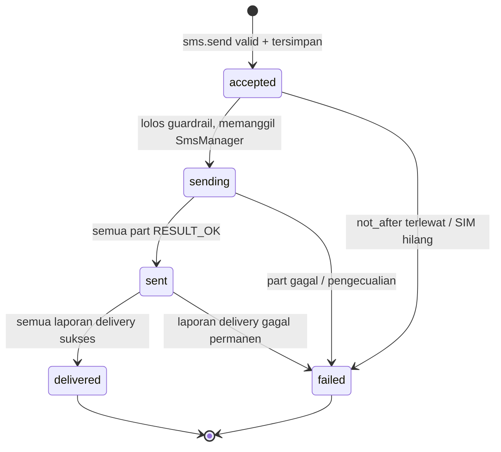
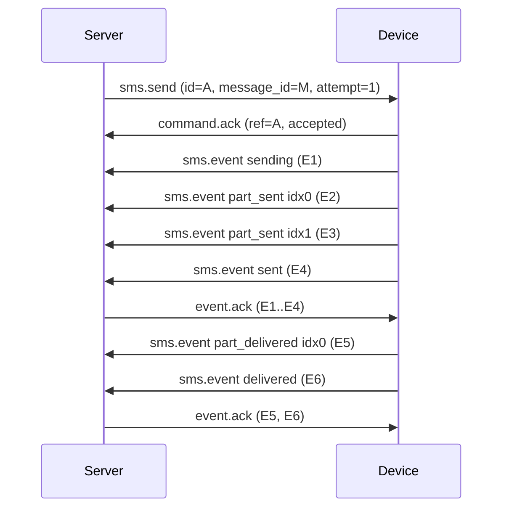

# Spec 06 — Spesifikasi Protokol Device (normatif)

Dokumen ini adalah lapisan **normatif** di atas [`contracts/device-ws-protocol.md`](../../contracts/device-ws-protocol.md) (daftar pesan & payload) dan [`contracts/ws-schema.json`](../../contracts/ws-schema.json) (JSON Schema). Kata **HARUS/TIDAK BOLEH/SEBAIKNYA** mengikuti RFC 2119. Uji kepatuhan: `python3 contracts/tools/validate_vectors.py` (skema) + checklist §8.

## 1. Versi dan negosiasi

1. Versi protokol saat ini `1`, diumumkan di subprotocol `smsc.v1` dan `v` pada envelope.
2. Server HARUS menolak upgrade jika versi minimum yang didukung > versi app (close `4426`). Server SEBAIKNYA tetap melayani versi lama selama masa dukung (≥ 2 rilis minor).
3. Perubahan kompatibel: menambah field opsional, tipe pesan baru, nilai enum baru pada pesan server→device **yang diabaikan jika tak dikenal**. Perubahan merusak menaikkan `v`.
4. Penerima HARUS mengabaikan field dan `type` yang tidak dikenal; `type` tak dikenal yang memiliki `id` dibalas `error{fatal:false, code:"unknown_type"}`.

## 2. Sesi

| Aturan | Rincian |
|---|---|
| S1 | Device HARUS membuka koneksi; server TIDAK BOLEH mencoba menghubungi device. |
| S2 | Pesan pertama dari device HARUS `hello`; pesan lain sebelum `hello.ack` diabaikan dan sesi ditutup `1008` bila lebih dari 3. |
| S3 | `hello.ack` HARUS tiba ≤ 10 dtk; jika tidak, device menutup & backoff. |
| S4 | Server HARUS menutup sesi lama dengan `4409` ketika sesi baru untuk device yang sama lolos autentikasi. |
| S5 | Semua `id` pesan HARUS unik per pengirim; penerima SEBAIKNYA menyimpan 1.000 `id` terakhir untuk membuang duplikat transport. |
| S6 | Pemutusan oleh server karena revoke HARUS memakai `4401`; device HARUS menghentikan reconnect dan menghapus kredensial. |

## 3. Pewaktuan (parameter yang dapat dikonfigurasi)

| Parameter | Default | Sumber | Catatan |
|---|---|---|---|
| `ws_ping_interval_sec` | 20 | config | Ping WS level protokol; 2× tak ada pong → putus |
| `heartbeat_interval_sec` | 30 | `hello.ack` | |
| `offline_after_seconds` | 90 | server | Tanpa heartbeat/ping |
| `ack_timeout_ms` | 15.000 | policy | Dari `sms.send` sampai `command.ack` |
| `sent_timeout_ms` | 120.000 | policy | Dari `sending` sampai event `sent`/`failed` |
| `delivery_timeout` | 24 jam | setting | Setelah itu `sent` dianggap final |
| `hello_ack_timeout` | 10 dtk | tetap | |
| Backoff reconnect | 1 → 60 dtk, full jitter | config | Reset setelah 60 dtk stabil |
| Grace rotasi kredensial | 60 dtk | tetap | Secret lama masih sah |

## 4. State machine job di device

Aturan:

1. **D1 (persist-before-act).** Device HARUS menyimpan `sms_job` berstatus `accepted` sebelum membalas `command.ack{accepted:true}`, dan HARUS menyimpan `sending` sebelum memanggil `SmsManager`.
2. **D2 (dedup).** Untuk `message_id` yang sudah ada dengan `attempt` ≥ `attempt` masuk, device TIDAK BOLEH memanggil `SmsManager` lagi. Balasan: `accepted:false` dengan `reason` `duplicate` (job `accepted/sent/delivered/failed`) atau `already_sending` (job `sending`). Event terminal yang tersimpan tetap dipublikasikan ulang lewat outbox bila belum di-ack.
3. **D3 (urutan).** Per `message_id`, event HARUS dibuat dalam urutan state di atas; `event_id` unik per event; `part_*` boleh bersisipan.
4. **D4 (outbox).** Setiap event HARUS ditulis ke outbox dalam transaksi yang sama dengan perubahan `sms_job`; HARUS dikirim ulang setiap koneksi baru sampai `event.ack`.
5. **D5 (privasi).** `body` HARUS dihapus dari penyimpanan lokal saat job terminal.
6. **D6 (guardrail).** Device TIDAK BOLEH mengirim lebih cepat daripada `min_gap_ms` per slot atau melampaui `max_per_minute`/`os_sms_guard`; penundaan ini bukan kegagalan.
7. **D7 (kadaluarsa).** `now > not_after` pada saat akan memanggil `SmsManager` ⇒ `failed(expired)` tanpa mengirim.

## 5. Aturan server

1. **V1 (lease).** Server HANYA mengirim `sms.send` untuk pesan berstatus `assigned` yang lease-nya berlaku. Mengirim ulang setelah reconnect diperbolehkan (D2 menanganinya).
2. **V2 (idempotensi event).** Server HARUS mengabaikan event dengan `event_id` yang sudah diproses (tetap membalas `event.ack` untuk id tersebut).
3. **V3 (event usang).** Event dengan `attempt` < attempt terkini pesan HARUS dicatat tetapi TIDAK BOLEH mengubah status, kecuali pesan `unknown` (koreksi dari outbox).
4. **V4 (urutan transisi).** Event yang melompati state (mis. `delivered` tanpa `sent`) diterima jika transisi hasil valid pada graf (`sending→delivered` diizinkan dengan mengisi `sent_at` = `delivered_at`).
5. **V5 (`event.ack`).** Dikirim setelah commit DB; dibatch ≤ 100 ms/≤ 500 id.
6. **V6 (rekonsiliasi).** Mengikuti algoritma `hello` (spec 04 §6).
7. **V7 (perintah terbatas).** Satu-satunya perintah selain `sms.send/cancel`/`config.update` adalah enum `device.command.action`.

## 6. Pembatalan

`sms.cancel{message_id}`: device menjawab `command.ack`:

| Kondisi job di device | Balasan | Efek |
|---|---|---|
| tidak ada | `accepted:true` | server menganggap sudah bersih |
| `accepted` (belum `sending`) | `accepted:true` | job dihapus/ditandai `failed(cancelled)` lokal tanpa event ke server |
| `sending`/terminal | `accepted:false, reason:"already_sending"` | server menolak pembatalan (409) |

## 7. Pembaruan konfigurasi

`config.update` dengan `config_version` lebih kecil/sama dari lokal diabaikan (tetap di-`command.ack`). Device menyimpan `config_version` terakhir dan mengirimnya di `hello`; jika lebih rendah dari server, server mengirim `config.update` setelah `hello.ack`.

## 8. Checklist kepatuhan implementasi

**Device**

- [ ] Menolak/mengabaikan `type` tak dikenal tanpa putus koneksi.
- [ ] `hello` memuat `inflight` dan `pending_events` yang akurat setelah proses dimatikan paksa.
- [ ] D1–D7 dibuktikan oleh uji instrumented (kill proses di tiap titik).
- [ ] Menyimpan `event` di outbox sebelum kirim; menghapus hanya setelah `event.ack`.
- [ ] Menutup & backoff bila `hello.ack` tidak tiba.
- [ ] Menangani semua close code pada tabel protokol §4.
- [ ] Tidak menulis `body` ke log.

**Server**

- [ ] Satu sesi per device; `4409` pada sesi lama.
- [ ] Rekonsiliasi `hello` menghasilkan `drop/keep` yang benar untuk 6 kombinasi status.
- [ ] Idempoten terhadap `event_id` dan event usang (V2–V3).
- [ ] Tidak ada tulis konkuren pada satu soket.
- [ ] Batas rate/ukuran ditegakkan (`4429`).
- [ ] Semua respons divalidasi terhadap `ws-schema.json` pada uji.

## 9. Test vector dan alat

- `contracts/test-vectors/valid/*.json` (16 pesan) HARUS lolos skema; `invalid/*.json` (13) HARUS ditolak.
- Setiap implementasi (Kotlin, Go) menjalankan semua vector pada unit test dengan pustaka JSON Schema 2020-12 atau parser tipe-nya, ditambah uji *round-trip* (serialisasi → validasi skema).
- Penambahan pesan/field baru: ubah `ws-schema.json` → tambah vector valid & invalid → perbarui kontrak/spec → baru implementasi.

## 10. Urutan pesan referensi (satu SMS 2 part)

